# Index figuri

Imaginile sunt în acest folder (fig01.png ... fig11.png).

## Fig 1: Atom de C nular (metan, CH4)
Secțiune: Tipuri de atomi de carbon > Nular

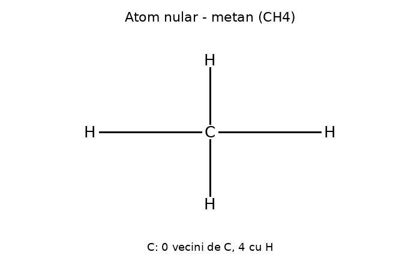

## Fig 2: Atom de C primar (etan, C2H6)
Secțiune: Tipuri de atomi de carbon > Primar

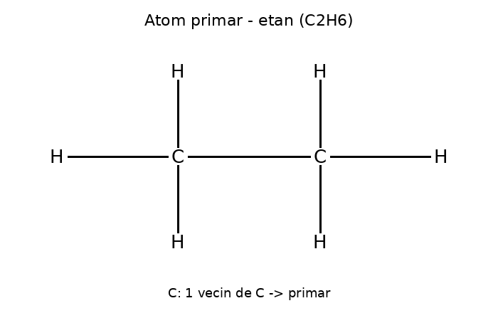

## Fig 3: Atom de C secundar (propan, C3H8)
Secțiune: Tipuri de atomi de carbon > Secundar

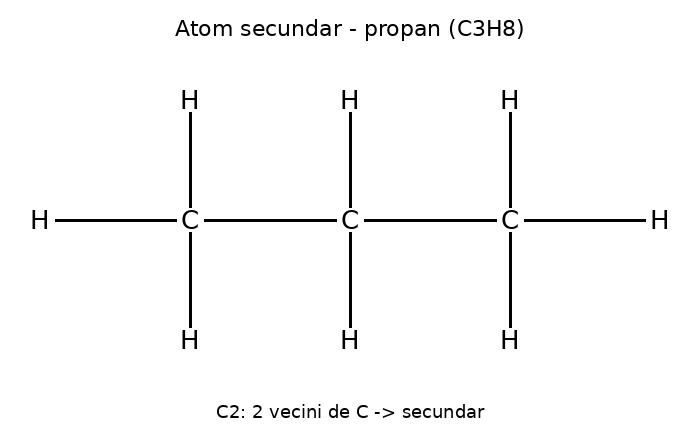

## Fig 4: Atom de C terțiar (2-metilbutan, C5H12)
Secțiune: Tipuri de atomi de carbon > Terțiar

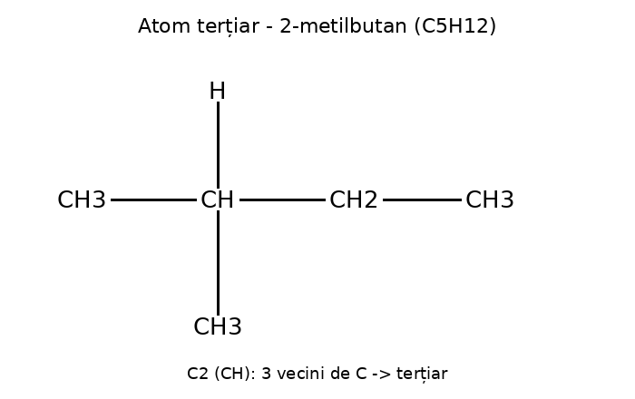

## Fig 5: Atom de C cuaternar (3,3-dimetilbut-1-ină, C6H10)
Secțiune: Tipuri de atomi de carbon > Cuaternar

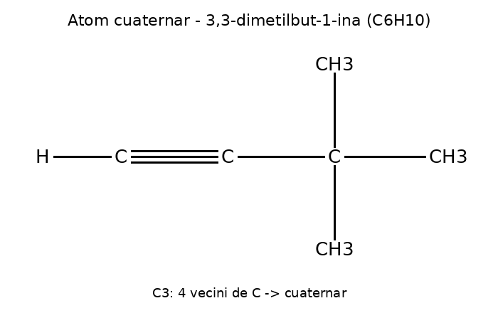

## Fig 6: Formula structurală plană cu linii de valență (3-metilpent-1-ină, C6H10)
Secțiune: Formule > Formula structurală > a) cu linii de valență

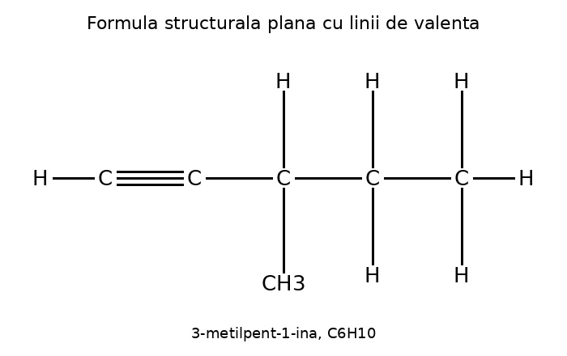

## Fig 7: Formula de poziție plană rezumată (3-metilpent-1-ină)
Secțiune: Formule > Formula structurală > b) de poziție plană rezumată

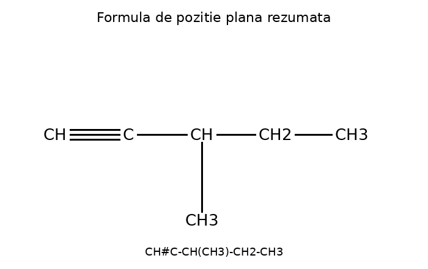

## Fig 8: Scheletul catenei (se dă)
Secțiune: Aplicație > Se dă scheletul catenei

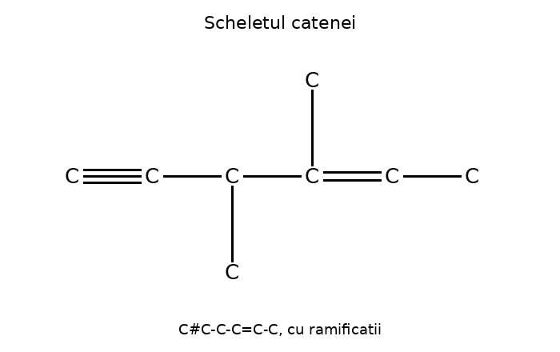

## Fig 9: Completarea cu H a catenei
Secțiune: Aplicație > a) Completarea cu H

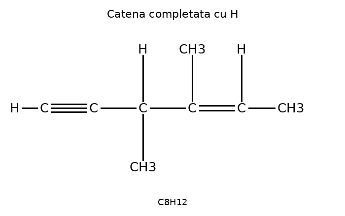

## Fig 10: Naftalina (inele condensate, C10H8)
Secțiune: Hidrocarburi aromatice > Polinucleare > a) cu inele condensate

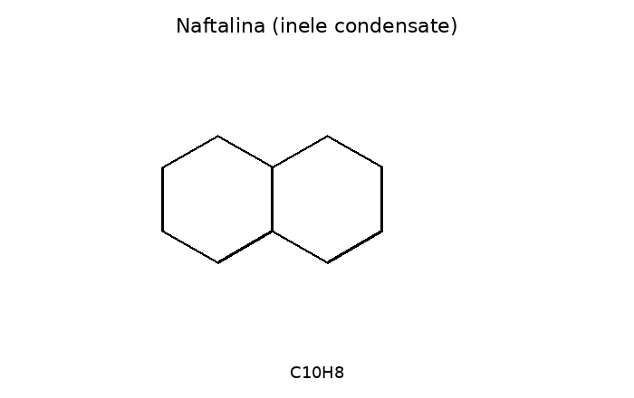

## Fig 11: Bifenil (inele izolate, C12H10)
Secțiune: Hidrocarburi aromatice > Polinucleare > b) cu inele izolate

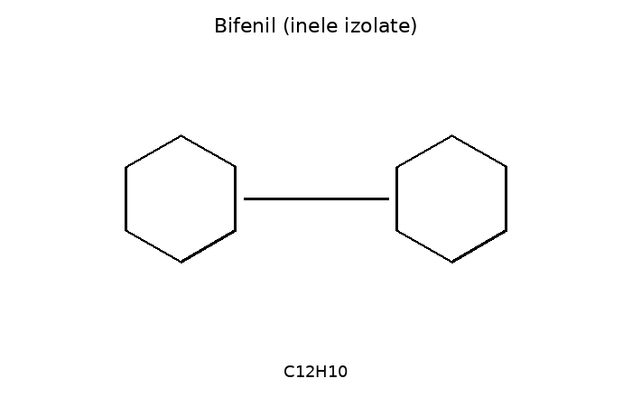
